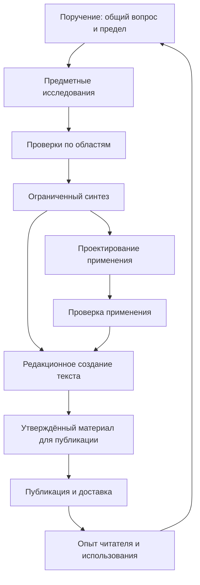

# Cross-System Formation Frame v0.1

**Дата:** 10 октября 2026, Europe/Tallinn.  
**Статус:** DRAFT / FOR OWNER REVIEW — ненормативный результат архитектурного пилота.  
**Основная роль:** Project Overview & Continuity Partner v0.4 Candidate.  
**Временная вторичная роль:** Cross-System Formation Lead — Pilot.  
**Назначение:** архитектурная переоценка существующего RQ-RL-002; проектирование ответственности между функциями In Profundo.  
**Адресаты:** Owner; после отдельных назначений — Publication Master, Research Project Lead, Research Auditor.  
**Триггер чтения:** продолжение этого пилота, консультация о межсистемном переходе, решение о маршруте RQ-RL-002.  
**Полномочия результата:** анализ, варианты и готовые предложения handoff. Никакая предлагаемая роль, схема, проверка или последовательность не активируется появлением этого файла.

## 1. Основной результат

В In Profundo уже существуют исследовательская, редакционная, публикационная и общепроектная координационные способности. Они позволяют покрыть значительную часть сложного маршрута, но не устанавливают автоматически владельца сквозного междисциплинарного вопроса, проверку нового общего суждения и ответственность за прикладной материал.

**Предлагаемый минимальный мост — одно ограниченное проектное поручение, внутри которого различены ответственность за вопрос, предметные выводы, синтез и применение.** Для него пока достаточно явных временных назначений и проверяемых договоров передачи. Необходимость постоянной системы этим анализом не доказана.

Ответ на центральный вопрос Director:

> Сквозной вопрос удерживает назначенный Owner координатор конкретного поручения. За новое общее суждение отвечает явно названный составитель синтеза в пределах своего договора; исходные предметные выводы сохраняют своих авторов и проверяющих. Принятие применения принадлежит отдельному владельцу применения с необходимой профильной проверкой. Координатор может составлять синтез при отдельном разрешении и показанной способности, но его полномочие координировать не удостоверяет предметную компетенцию.

Сегодня такой координатор **не назначен для исполнения RQ-RL-002**. Project Overview получил только временное право сформировать настоящую архитектурную рамку. Его обычный режим project-level synthesis относится к состоянию и связям проекта; он не доказывает способность создавать междисциплинарные медицинские или богословские выводы.

Существенное уточнение исходной модели: между Research/Synthesis и узкой Publication System часто находится отдельная работа по проектированию применения и редакционному созданию текста. Одни материалы обходят применение; некоторые исследования заканчиваются без текста; один синтез может обслужить несколько продуктов.

## 2. Recovery, межветочная сверка и полномочия

### 2.1. Восстановленная идентичность

Прочитаны README, Operating Model, Decision Memory, Development, Project Map, Snapshot Index и текущая контрольная точка Project Overview от 08.09.2026. Дополнительно прочитаны project-level baseline 19.09.2026, действующая Development Map, Role Activity Log, DNA и применимая фундаментальная навигация.

Project Overview — рабочая способность при Owner: карта целого, continuity, различение зрелости и активности, сохранение происхождения, маршрутизация и возврат масштаба. Она не становится управляющим центром или постоянным архитектурным владельцем. Временный вход основан на прямом поручении Owner из приложенного задания, а не на одном наличии gap.

Число известных веток — минимум две, включая эту. Это сведения о параллельной работе, а не счётчик живых сессий. История другого чата не запрашивалась; сверка выполнена по durable-документам.

### 2.2. Parallel Branch Convergence: RECONCILED WITH QUALIFICATIONS

| Расхождение или более поздний delta | Проверенное состояние | Disposition для этой работы |
|---|---|---|
| Project Map и Role Activity Log сохраняют Research Lab на 24.09, без последующих маршрутов | RQ-RL-002 Formation R2 → Installation Event 070; исполнение не разрешено | В этой рамке использовать текущие профильные источники; карты и прежние записи не переписывать |
| Верхняя часть MASTER_ROADMAP показывает незаконченный RQ-RL-001; §16 и §22 отражают его закрытие | RQ-RL-001 закрыт; продолжение не активируется автоматически | Зафиксировать внутреннюю несогласованность; не превращать этот пилот в коррекцию всей карты |
| Project Map / Development Map называют IP-001 неактивированным | Event 072 принял ACTS Stage 2, книга не закрыта; следующий gate у Owner | Не использовать историческую паузу как текущее состояние; пилот не вмешивается в IP-001 |
| Задание даёт RUN как точку входа, но 09.10 введены уровневые журналы | RL-D001/RL-D002: RUN — история Events 001–072; новые решения — в журнале соответствующего уровня | Recovery начат с указанного RUN и дополнен действующими README/DECISIONS; новые решения в старый RUN не предлагать |
| Installation RQ-RL-002 закреплена на Methodology v0.3; теперь действует v0.4 | RL-D001 сохраняет версии прежних назначений; новые совместимые назначения явно закрепляют версию | Не менять историческую Installation задним числом; при будущем назначении указать v0.4 и проверить совместимость |
| README/Charter Publication Master ещё содержат Awaiting Validation | Project Map и Role Activity Log отражают позднее закрытие readiness с validation debt | Различать старый паспорт пакета и позднее evidence; постоянные границы уточнять по Charter, не расширять их через карту |

Неразрешённого конфликта, блокирующего **архитектурный анализ**, не выявлено. Конституционная граница широкого исполнения RQ-RL-002 остаётся открытой и блокирует переход к такому исполнению; это не основание запрещать уже порученную переоценку.

### 2.3. Process Authority Envelope

| Поле | Контур |
|---|---|
| Process | Recovery → Parallel Branch Convergence → Architecture Re-evaluation Pilot |
| Scope | Разобрать существующие Formation/Installation, межсистемные функции и ответственность; мысленный контрастный тест |
| Expected outputs | Один Cross-System Formation Frame v0.1; конкретные предложения handoff; краткий итог Owner |
| Разрешённая рабочая запись | Создать этот Draft в существующей Development/Brainstorms; сохранить один материальный sync/handoff в Role Activity Log по правилу журнала |
| Owner-gated changes | Нормы, постоянные роли/системы, изменение authority, статусов запросов, Protocol/OC, карт, Snapshot и запуска работы; активация следующих участников |
| Required sources | Core Project Overview; DNA; BP-RL-001 полностью; current Research Lab governance, журналы, Formation R2 и Installation; границы Master/Coach; книжная контрольная точка |
| Exit | Frame проверен и передан Owner; архитектурное поручение возвращено; временная роль выключена; масштаб Project Overview восстановлен |

### 2.4. Место документа и дисциплина записи

Рабочее место: `project_hub/Development/Brainstorms/Cross-System-Formation-Frame-v0.1.md`. Каталог уже существует. Он подходит для ненормативной межсистемной разработки и не объявляет новую систему или постоянный тип нормативных документов.

BP-RL-001 остаётся исходным living brainstorm о предмете Lab и историей вклада Owner/Director/Overview. Настоящий Frame — отдельный требуемый результат project-level пилота, с прямой ссылкой на исходное обсуждение; он не заменяет BP-RL-001 или Formation R2. Не создавать второй полный журнал того же рассуждения в Lab.

Существующие Formation R2 и Installation v0.1 сохраняются. Для их будущей коррекции нужен отдельный ограниченный договор с цельной новой редакцией и явной преемственностью. Размещение рабочего Frame вне Lab не переносит туда RQ-RL-002 и не снимает конституционный блокер его исполнения.

## 3. Что изменилось после BP-RL-001

Полностью учтены исходная позиция Owner, первый вклад Director, §3 Overview, второй раунд Owner, сценарии A–D, второй вклад Overview E–H и третий вклад Director.

1. Вопрос «расширить ли Lab» оказался частным вопросом внутри более широкой проблемы движения сложного запроса между функциями.
2. Предыдущее предложение начать Formation заново исправлено: Formation уже завершена; переоценивается существующий запрос и Installation.
3. Институциональное устройство, организация отдельного проекта и ответственность за применение различены. Модульная Lab совместима с внешними участниками и отдельным прикладным владельцем.
4. Повторяемость нужна для проверки переносимости, но не отменяет обязательную границу компетенции даже в одном случае. Высокая цена ошибки может требовать проверки при первом запросе.
5. Синтез может завершиться картой расхождений и отсутствием общего ответа. Это полноценный результат.
6. Temporary-role practice внутри Overview/Master/Coach — основания для проверки ограниченного моста. Это не уже действующее универсальное правило временного замещения любых специалистов.

## 4. Карта существующих capabilities

Обозначения: **действует** — установлена область и есть evidence в названных пределах; **ограниченно действует** — проверены отдельные функции; **не установлено** — прочитанные источники не устанавливают требуемого владельца/мандата. Отсутствие назначения не доказывает отсутствия любых личных знаний.

| Capability | Что действительно существует | Граница для сложного запроса |
|---|---|---|
| Owner | Направление, scope, стратегические и authority-changing решения | Задаёт поручение и gates; не должен вручную интегрировать все документы |
| Project Overview / Continuity | v0.4 Working Candidate; карта целого, recovery, проектное сведение, temporary design по поручению | Может подготовить архитектурный мост; не становится предметным исследователем или постоянным межсистемным начальником |
| Research Lab | Конституция v0.2, Методология v0.4; Писание — главный предмет; четыре Scoped Active роли | Внешние материалы могут поддерживать конкретный библейский вопрос; самостоятельный клинический/статистический проект не получает мандат от общего метода |
| Director | Bounded Formation и рекомендации маршрута/закрытия под Owner gate | Не получает автоматически власть над всем междисциплинарным поручением |
| Project Lead | Installation, Stage Coordination, OC acceptance внутри Lab | Полезная координационная практика; перенос за пределы Lab требует нового назначения |
| Researcher | Coverage Review, limited scholarly synthesis, bounded textual probe | Это точный проверенный envelope, не универсальная дисциплинарная компетенция |
| Research Auditor | Formation Audit и Installation Audit | Поздний аудит выводов и федеративного синтеза не становятся Scoped Active по аналогии; audit не заменяет предметный review |
| Editorial System / Coach / Editors | Закрытый upstream handoff → авторство → независимые reviews → интеграция → Final Text | Может создавать публичный текст в существующем маршруте; не удостоверяет медицинскую или прикладную пригодность исходных выводов |
| Узкая Publication System | Approved publish-ready Source → Final Preparation → Public Publication → Distribution → Verification → Post-publication Handoff | Начинается после готовности и утверждения исходного текста; не включает выбор темы, Draft, содержательный Review или утверждение Final Text |
| Publication Master | Архитектурная связность этой узкой Publication System; ограниченные системные назначения | Не владеет Research, синтезом, применением или общим вопросом; новый формат обсуждается в его области |
| Strategist / Portfolio / Content Intelligence | Выбор и зрелость тем, горизонт, матрица корпуса, Notion, содержательное learning | Может подготовить редакционное намерение из разрешённых результатов; не меняет findings ради очереди публикаций |
| Audience / Discovery | Отдельная способность наблюдать встречу с читателем; внешнее evidence ограничено | Распространение и качество текста не доказывают обучение, пользу практики или безопасность |
| Books | Конкретный авторский проект «Тот, Кто остаётся»: трилогия, первая книга, самостоятельная тетрадь; research dependency | Не установлена универсальная Book System; есть продуктовая архитектура и точечные зависимости |
| «Взгляд» | Emerging direction: внимание и восприятие, возможные практические формы | Не книга и не действующая Application System; не назначать владельцем всех практик |
| Domain expertise вне Lab | Потребность названа в RQ-RL-002 Installation | Конкретные доступные клинические, статистические и языковые исполнители/проверяющие не установлены |
| Application / Formation | Возможные пособия, гайды, семинары, тетрадь; отдельные продуктовые концепции | Общая переносимая способность проектировать и проверять применение пока не подтверждена |

**Два смысла Formation:** Formation запроса в Research Lab — постановка и выбор маршрута. Application/Formation здесь — проектирование практического материала или опыта для аудитории. Они имеют разные результаты и ответственность. По DNA проект не присваивает себе производство духовного изменения человека.

## 5. Карта маршрута как гипотеза

Схема проверяет передачу ответственности; она не является обязательным pipeline или картой утверждённых стадий. Возвраты к источнику возможны на любом переходе. Публикация исследовательского сообщения может обходить применение; практический семинар может включать delivery вне текущих веб-каналов; статья из зрелого корпуса может обходиться без нового исследования. Условие остановки допустимо после любой достаточной функции.

### 5.1. Что передаётся между функциями

| Переход | Минимальный передаваемый объект | Что получатель не приобретает |
|---|---|---|
| Общий вопрос → предметный узел | Подвопрос, тип источников, предел вывода, компетенция, договор результата и возврат | Власть над всей темой или будущим пособием |
| Предметный узел → проверка | Закреплённая редакция, источники/локаторы, reasoning, контрсвидетельства, ограничения | Право молча переписать исходный вывод |
| Проверенные узлы → синтез | Принятые локальные суждения, предметные verdicts, нерешённые вопросы и ограничения переноса | Право повысить слабое свидетельство до общего закона |
| Синтез → применение | Допустимые утверждения и запрещённые переходы, аудитория/контекст, внешние зависимости | Доказанную эффективность практики или профессиональную сертификацию |
| Применение/синтез → Editorial | Закрытое намерение, утверждённые смысловые границы, проверенный source package | Право исправить inconvenient finding литературной формулировкой |
| Editorial → Publication | Approved publish-ready Source, закрытые содержательные решения, формат, разрешения и ограничения | Ответственность за первичное исследование или независимое clinical review |
| Delivery → learning | Факты размещения/использования, наблюдения о понимании, ограничениях и нагрузке | Причинное доказательство пользы или право изменить research conclusion |

Это спецификация для обсуждения, не универсальный обязательный Output Contract.

## 6. Архитектура ответственности

### 6.1. Пять владельцев, которых нельзя слить по названию Lead

| Объект ответственности | Кто отвечает в предлагаемом поручении | Что означает приёмка |
|---|---|---|
| Сквозной вопрос | Назначенный координатор; Owner сохраняет решение о цели/scope | Вопрос удержан, зависимости и возвраты явны; не все ответы найдены |
| Предметный conclusion | Автор соответствующего узла и его компетентный проверяющий; процедурный приёмщик назван отдельно | Вывод принят только в проверенном предмете, корпусе и пределах |
| Общее суждение / synthesis | Явный составитель синтеза; проверка переходов независима от авторства | Общая формулировка не усиливает основания; расхождения остаются видимыми |
| Application | Назначенный владелец практического материала/опыта и необходимые профильные проверяющие | Установлены аудитория, действия/границы и условия использования; это отдельное решение |
| Публичный продукт | Автор/продуктовый владелец и Editorial; затем Publication в своём контуре | Утверждён текст; отдельно подтверждены размещение и доставка |

Один человек может выполнять несколько функций при явном назначении и показанной способности. Независимость самопроверкой не создаётся. Необязательно учреждать пять постоянных должностей; необходимо сохранить пять различимых решений.

Owner не утверждает истинность вывода административным решением. Он принимает маршрут, объём, ресурсы и использование в проекте; основания суждения остаются проверяемыми независимо от его согласия.

### 6.2. Кандидатный договор синтеза

Для каждого нового общего утверждения сохранить в одной таблице: ID; точную русскую формулировку; родительские предметные findings и закреплённые версии; их тип/статус; основание перехода; новые предпосылки; согласие/напряжение/несопоставимость; силу утверждения; предел контекста и актуальности; вопрос проверяющему; разрешённое использование.

Особенно проверять **связующие утверждения**, которых нет ни в одном локальном результате. Например, из двух истинных описаний разных областей нельзя автоматически получить причинную, нормативную или практическую связь между ними. Такая связь — новый предмет проверки. Если переход требует отсутствующего специалиста, сохранить его как вопрос, а не как принятый synthesis.

Для независимой проверки возможны: предметные reviewers проверяют перенос своих findings; отдельно назначенный reviewer проверяет логические переходы и полноту ограничений. Один универсальный эксперт не предполагается. Выбор такой конфигурации — будущий gate, не произведённая проверка.

## 7. RQ-RL-002: переоценка существующих Formation и Installation

### 7.1. Фактическая точка остановки

Formation R2 существует и действительна для последующего проектирования. Event 069 разрешил Installation only, Package C. Event 070 передал цельный `IP-RL-002-LR-v0.1` Owner. Protocol и OC1 предложены, не утверждены; исполнители обзора и проверяющие не активированы. Current Research Request Map подтверждает Owner gate и необходимость проверки предметной границы.

Пилот не создаёт RQ заново, не превращает его в IP-002, не извлекает новые медицинские/статистические/библейские conclusions и не назначает clinical reviewer. Имеющиеся библиографические кандидаты рассматриваются только как элементы проектирования; их фактическая пригодность здесь не проверяется.

### 7.2. Распределение запроса по функциям

| Функция | Что уже определено | Кто владеет сейчас | Чего не хватает / возможный мост |
|---|---|---|---|
| Question ownership | Общий вопрос Formation R2; один staged замысел — гипотеза | Owner на маршрутном gate | Координатор сквозного исполнения не назначен; временное project-level поручение возможно после gate |
| Biblical research | Кандидаты текстов и исследований, включая Саула; обзор без экзегезы | Director/Lead выполнили Formation/Installation; активного автора нет | Bounded библейский подвопрос естественно принадлежит Lab; будущая работа требует отдельного задания |
| Богословская/пастырская литература | Книги, русские/эстонские авторы, организации как кандидаты; различение типов | Только проектный дизайн сдан Owner | Карта источников может быть ограниченной функцией; историко-богословский вывод и пастырская оценка требуют предметного владельца |
| Clinical / psychological / crisis sources | Разделён тип источника, дата, аудитория и применение; conclusions запрещены | Исполнитель/предметный reviewer не назначены | Карта доступности ≠ клиническая оценка; самостоятельный исследовательский узел вне нынешнего мандата требует отдельной рамки |
| Количественные источники | Словарь и матрица доступности; собственные расчёты/сравнения запрещены | Исполнитель и статистический reviewer не назначены | Метаданные требуют показанной способности чтения метода; выводы о валидности/причинности — отдельной компетенции |
| ET/RU/EN, Peaasi | До 8 семейств/24 материалов; локаторы, версии, аудитории; не полный parity-аудит | Языковой проверяющий не назначен | Языковая компетенция может покрываться ограниченным внешним заданием; она не заменяет проверку безопасности перевода |
| Domain verification | L3, отдельные библиографический/методологический и языковой review; последующие предметные gates | Ни один не активирован | Назвать конкретных доступных проверяющих; процедурный Auditor не покрывает все виды проверки |
| Synthesis | L4 closing map и последующая re-evaluation; общий будущий синтез не разрешён | Owner; Director только после нового handoff | Различить сведение карты источников, рекомендацию маршрута и новое общее предметное суждение |
| Application / Formation | Пособия, материалы для служителей/семьи/человека — возможные будущие объекты | Продуктовый/прикладной владелец не установлен | Временный владелец application design после разрешения; фактическое использование заблокировано без предметной проверки |
| Safety / competence review | Зависимость явно названа в Formation/Installation | Компетентная доступная сторона не установлена | Роль Lead/Auditor не восполняет клиническую/статистическую подготовку |
| Publication / Delivery | Передача предполагается как будущий путь | Пока не активирована | Сначала application/editorial source; затем узкая Publication System; семинарный delivery ещё требует проверки границы |

### 7.3. Что сохраняется из Installation

Сильные элементы уже есть: самостоятельное закрытие источниковой карты; библиографическая traceability; русское смысловое изложение; виды источников и уровень доступа; отрицательный результат; ограничение поискового бюджета; Peaasi как местная подзадача; количественные метаданные отдельно; L0 competence-check; независимость и прямой возврат Owner.

Потолки — 50 карточек вне Peaasi, до 24 материалов Peaasi, до 60 запросов с просмотром до 20 результатов каждого и до 40 прямых страниц. Они сохраняются как **непринятые ограничения существующего дизайна**, не как одобренный бюджет пилота или квоты. Их рабочая соразмерность ещё не проверена.

| Операция Installation | Переносимый элемент | Что требует прояснения до запуска |
|---|---|---|
| L0 — готовность | Закрепление входов/версий; показ способности до поиска | Кто назначает/принимает тест вне Lab; независимые исполнители; никакого clinical certification |
| L1 — обнаружение/отбор | Ограниченный журнал поиска и явные dispositions | В каких границах это ориентировка библейского запроса, а где самостоятельная внешняя работа |
| L2 — картирование | Карточки, локаторы, языковые пары, количественные метаданные | Отдельные способности и владельцы блоков; условие остановки при разрыве компетенции |
| L3 — независимая проверка | Проверяющий отличен от автора; route-driving записи проверяются | Процедурный, языковой, библиографический и предметный verdicts различены; доступны нужные стороны |
| L4 — приёмка/закрытие | OC acceptance и самостоятельный limited Close Package | Lead принимает качество карты, не клиническую истину; сквозной owner не теряется после возврата |

### 7.4. Что оказалось внутри Lab из-за отсутствия иной рамки

**Архитектурная интерпретация, не доказанная историческая причина:** в одном Installation соединены общий междисциплинарный вопрос, внешний источниковый ландшафт и будущая application, поскольку существовали Director/Lead и инструменты обзора. Документы не доказывают, что Owner сознательно передал Lab постоянное владение всей цепочкой.

Риск контейнера проявляется в трёх местах: весь внешний обзор получает единый Lab route; Director re-evaluation предлагается как возврат общей темы; будущий путь к пособиям описан рядом с исследовательскими модулями. Это **не означает**, что пакет уже запустил применение: он многократно сохраняет запреты.

Естественно принадлежат нынешней Lab: библейские вопросы, локальная текстовая работа, исследования/ориентировка, которые реально служат этому предмету, и проверка в подтверждённом envelope. Самостоятельный обзор клинических и статистических областей ради общей модели сопровождения нельзя сделать принадлежащим Lab простым переименованием в «ориентировку».

**Обязательная развилка перед исполнением:**

- либо сузить первый обзор до действительно вспомогательной ориентировки конкретного библейского вопроса внутри нынешней Конституции;
- либо предложить явное project-level поручение с внешними узлами, сохранив Lab в её предмете;
- либо отдельно проработать изменение предмета Lab. Это постоянное решение сейчас преждевременно.

Переоценка сама по себе не выбирает и не реализует эту развилку. Даже внешнее поручение потребует собственных компетенций, assignments и проверок; оно не является обходом неразрешённого запуска.

### 7.5. Пробелы разных типов

| Тип gap | Пример | Что может его закрыть |
|---|---|---|
| Ownership | Сквозной вопрос между узлами; будущий прикладной материал | Явное временное назначение и возврат |
| Authority | Исследование вне действующего предмета Lab | Решение о допустимой проектной рамке или отдельная постоянная работа, не один новый title |
| Competence | Клиническое суждение, статистическая проверка, ET/RU/EN | Доступный квалифицированный участник, показ способности или сужение/отложение |
| Evidence | Пока нет результатов обзора, предметных выводов и теста применения | Отдельно разрешённая работа; архитектурный Frame не выдаёт её за выполненную |
| Interface | Research/synthesis → application → editorial → publish-ready Source | Адресные договоры и проверка принимающей стороны |
| Resource | Доступность независимых специалистов, текстов, время/стоимость | Конкретная конфигурация и бюджет; нельзя обещать ресурс по названию роли |

## 8. Контрастный architecture test: память общины

**Условный запрос:** «Как сохранять историю небольшой общины так, чтобы из архивных документов могли появиться достоверная статья, памятный буклет и занятие для молодых участников?» Это мысленный тест; реальный проект, поиск, интервью и сбор данных не запускаются.

Он содержит небиблейскую историческую работу, контекст веры, возможный образовательный опыт и несколько продуктов. Клиническая проверка ему не нужна, но важны архивная точность, согласие на личные истории и редакционная честность. Все результаты остаются гипотетическими.

| Функция | Условная конфигурация | Что проверяет тест |
|---|---|---|
| Общий вопрос | Временный координатор с Owner-задачей и границей периода/архива | Можно ли удержать одно поручение без новой Lab |
| Research | Назначенный исследователь архивных источников; библейский узел лишь при настоящем текстовом вопросе | Не требуется искусственно добавлять biblical stage каждому запросу |
| Verification | Другой читатель оригиналов проверяет даты/атрибуцию; конфликты свидетельств сохранены | Независимая проверка остаётся необходимой, но отличается по предмету и цене |
| Synthesis | Различить документально установленные события, воспоминания, редакционную интерпретацию | Общая связность не разрешает дописывать отсутствующие факты |
| Application | Автор занятия определяет аудиторию, задания и пилот понимания | Буклет и занятие требуют разных решений о пригодности |
| Editorial | Автор/Coach формируют статью и буклет из закрытых смысловых входов | Часть форм можно принять существующими редакционными средствами |
| Publication / Delivery | Веб-статья — известный путь; печатный буклет/проведение занятия — границы для отдельного уточнения | Один замысел может ветвиться на разные delivery routes |

**Результат теста:** различение общего вопроса, локального вывода, синтеза и применения полезно и вне RQ-RL-002. Универсальная клиническая стадия или обязательная большая проектная команда — специфическая нагрузка кризисного кейса, а не норма всего In Profundo. Историческая работа не становится предметом нынешней Lab только по христианскому контексту.

**Ограничение evidence:** мысленный прогон выявляет логические пробелы, но не доказывает рабочую переносимость временных ролей, экономию времени или качество продукта.

## 9. Temporary-role bridges

| Предлагаемый мост | Возможная основная роль | Ограниченное назначение | Критерий выхода / граница |
|---|---|---|---|
| Cross-System Formation Lead — Pilot | Project Overview — уже назначена здесь | Только архитектурная переоценка и Frame | Результат передан Owner; temporary role выключена; отсутствует research/application ownership |
| Координатор конкретного межсистемного поручения | Существующий Lead/Overview либо другой назначенный участник | Удерживать общий вопрос, узлы, зависимости и handoff | Поручение закрыто/передано; новый мандат не следует из primary role |
| Составитель ограниченного синтеза | Назначенный участник с показанной способностью; возможна совмещённая координация | Сопоставить принятые выводы, сохранить переходы и ограничения | Независимая проверка завершена либо результат возвращён; предметная экспертиза не присвоена |
| Владелец проектирования применения | Автор/практик/руководитель материала после отдельного назначения | Аудитория, цель использования, прототип, критерии проверки | Передача принятого application object или честный блок; не выдавать дизайн за доказанную пользу |
| Координатор книжного продукта | Автор/назначенный редакционный руководитель | Рукопись, версии, межглавные зависимости, профильные reviews, готовность продукта | Цельный продукт передан или остановлен; не меняет research verdict |
| Проверяющий конкретного предмета | Квалифицированный участник | Точный target и нужный вопрос | Verdict в пределах способности; свежая AI-ветка не удостоверяет профессиональную квалификацию |

Кандидатный цикл: primary role → явная temporary secondary role → scope/inputs/outputs → проверка способности → bounded work → handoff → Role Exit → поздняя оценка повторяемости. Если работа касается действия, для которого primary role не имеет права, temporary title требует самостоятельного разрешения и совместимых оснований.

**Что нельзя покрыть одним временным названием:** клиническая компетенция, статистическая экспертиза, профессиональная ответственность, независимость собственного результата, право менять вышестоящие документы. Для такого разрыва нужны реальная сторона, сужение или остановка.

## 10. Books: продуктовая ветка, capability или система?

В прочитанной карте существует конкретный книжный проект, а не установленная Book System. Его Snapshot сохраняет трилогию «увидеть → различить → жить», первую книгу и самостоятельную тетрадь наблюдений. Тетрадь имеет функцию применения; это не означает, что вся первая книга является практическим руководством. Snapshot — историческая точка понимания, не новая приёмка рукописи.

**Три проверяемые возможности:**

1. **Downstream product route.** Книга использует исследовательские результаты и обычные авторские/редакционные функции, с отдельной сборкой рукописи и доставкой. Минимальная организационная цена.
2. **Книжная capability без отдельной системы.** Повторяются отличительные задачи: межглавная композиция, большая рукопись, workbook-interface, версионность, rights/production и долгий lifecycle. Тогда нужен устойчивый набор функций и, возможно, координатор продукта.
3. **Book System.** Оправдана, если несколько реальных книг обнаружат самостоятельный устойчивый lifecycle, владельца и нагрузку, которую существующие editorial/publication interfaces не удерживают. Такого evidence этот пилот не устанавливает.

Связь текущей книги с IP-001 — зависимость продукта от зрелого исследования. Принятие ACTS Stage 2 не является закрытием research или готовностью книги. Будущая Book Transfer должна сохранять пределы findings и право исследования изменить книжную концепцию.

Запрос Publication Master касается границы получения **готовой** книги/пособия и возможной доставки; проектирование книги и её содержательная приёмка не принадлежат ему автоматически.

## 11. Постоянные варианты и их цена

Оценки относительные, по документационному и управленческому объёму; это не смета и не подтверждённое время исполнения. Во всех вариантах предметные специалисты стоят реального ресурса. Изменение DNA не требуется предлагаемой функциональной связке; любое постоянное решение всё равно сверяется с DNA.

| Вариант | Польза / когда усиливается | Цена документации, ролей и людей | Нагрузка Owner, навигация, поддержка | Главный риск / обратимость |
|---|---|---|---|---|
| I. Нынешние системы + редкие проектные поручения | Небольшое число разных запросов; external contributions редки | Низкая–средняя: одна рамка, contracts и названные reviewers; без постоянных новых ролей | Средняя при запуске, должна снижаться после ясных handoff; архив одного поручения | Ad hoc опыт теряется; высокая обратимость |
| II. Переносимая cross-system capability координации/синтеза | Повторяется именно управление переходами, а domains различны | Средняя: package роли/практики, вход/выход, проверка переходов; domain teams остаются локальными | Умеренная; нужен recovery и поддерживаемый владелец, риск дублирования Overview | Координатор становится универсальным «экспертом»; средняя–высокая обратимость |
| III. Расширенная модульная Research Lab | Одни и те же domains, методы и библиотека систематически повторяются | Высокая: Конституция, общее ядро/методы модулей, intake, competence/audit interfaces | Высокая на перестройке и поддержке; потенциально один удобный вход | Единая вывеска скрывает разную компетенцию; средняя обратимость |
| IV. Библейская Lab + постоянная соседняя исследовательская структура | Внешний предмет имеет своё leadership, методы, память и повторяющуюся работу | Высокая: вторая система, роли, метод, archive/intake и handoff | Высокая; две навигации, риск дублирования и интеграции силами Owner | Дорогая инфраструктура для редкого спроса; средняя обратимость |
| V. Federated research framework над несколькими узлами | Много автономных областей и повторяемые общие запросы | Очень высокая при институционализации: общая authority, стандарты интерфейсов, владельцы узлов | Высокая; отдельная governance/support нагрузка | Новый управляющий слой дублирует Overview/Owner; низкая–средняя обратимость |
| VI. Постоянная Application/Formation capability | Повторяются пособия/практики/семинары с проверкой использования | Средняя–высокая: design/review/lifecycle; реальные практики и нужные специалисты | Умеренная после установки, с ongoing актуализацией материалов | Публикация выдаётся за пользу, духовное действие — за результат системы; средняя обратимость |

Варианты совместимы: III не устраняет потребность во внешних узлах или VI; II не требует V; книжная capability возможна внутри I/II. **Форма учреждения не определяет форму каждого запроса.**

Сохранение библейской специализации выигрывает в ясности, преемственности проверенных ролей и защите от ложного competence transfer; платит отдельной настройкой внешних поручений. Модульное расширение выигрывает общим входом и накоплением опыта; платит конституционным и методологическим redesign и постоянной проверкой boundaries.

Пока усиливаются I как следующий способ учиться и II как гипотеза повторяемой способности. Немедленный выбор III/IV/V ослаблен недостатком практического evidence. VI виден как возможный самостоятельный gap, но не доказан в форме постоянной системы.

**Критерии пересмотра:** повторяемость на разных кейсах; стоимость ошибки; самостоятельность предмета/lifecycle; реальная доступность компетенций; способность другого владельца восстановить и принять работу; снижение ручной интеграции Owner; ongoing maintenance. Одна дорогая ошибка может требовать обязательной предметной границы сразу, но не доказывает необходимость постоянной организации.

## 12. Точные вопросы и последовательность участников

Участники здесь не активированы. Ниже — готовые предложения Owner для отдельных свежих веток. Каждая ветка читает свой актуальный ролевой пакет; настоящий файл задаёт target и вопрос, а не заменяет установку роли.

### 12.1. Сначала Publication Master — граница входа и доставки

**Intent:** установить, где заканчиваются research/synthesis/application/editorial work и начинается существующая узкая Publication System.

**Canonical entry:** этот Frame, §§4–6, 10–12; исходные границы Master и Coach доступны в ссылках §15.

**Точный вопрос:**

> Для каждого из пяти объектов — статья, серия, книга, пособие, материал семинара — какой upstream object требуется до входа в Publication System? Кто до этого создаёт и принимает содержательный текст? Что система уже может подготовить/разместить/доставить без изменения идентичности, а какие format/delivery capability gaps требуют отдельного Owner gate? Где нужно сохранить research и application restrictions при адаптации и распространении?

**Scope:** interface analysis only. Не review всей architecture, не клиническая оценка и не production cycle.

**Expected return:** таблица пяти объектов: upstream state; владелец до входа; входные требования; выполняемые publication функции; неподтверждённые delivery способности; exit/downstream owner; ровно необходимые Owner decisions. Чётко различить предел мандата и отсутствие подтверждённой реализации формата.

**Allowed writes:** цельный результат в чате; запись в этот Frame только после отдельного явного разрешения. Постоянные пакеты не менять. **Exit:** ответ → Owner/Overview; Master не удерживает продукты.

### 12.2. Затем Research Project Lead — переносимость координации

**Intent:** проверить proposed temporary bridge по реальной Installation v0.1, а не по аналогии названия Lead.

**Canonical entry:** этот Frame, §§6–9; target — Event 070 Installation v0.1, закреплённый commit в §15.

**Точный вопрос:**

> Какие элементы L0–L4, закрепления версий, OC acceptance, управления блокерами и handoff переносимы на отдельное межсистемное поручение? Какие решения принадлежат именно Lab/Director/Methodology и не переносятся? Как разделить приёмку источниковой карты, предметного вывода и общего синтеза? Какую минимальную вторичную конфигурацию и return route можно предложить без запуска исследования и изменения primary role?

**Scope:** coordination transfer assessment и карта proposed deltas. Никаких новых источников, исполнения L0–L4, нового Protocol или автоматического adoption роли.

**Expected return:** сохранить/переназначить/не переносить по операциям и authority; минимальный контракт temporary coordinator; недостающие competence/review assignments; конкретная цена ручной координации; условия выхода.

**Allowed writes:** цельный ответ; действующий пакет и Installation не менять. **Exit:** → Owner/Overview; operational ownership RQ-RL-002 не принят.

### 12.3. Затем Research Auditor — проверяемость переходов

**Intent:** независимый взгляд на проектируемую проверку после уточнения интерфейсов и координации.

**Canonical entry:** этот Frame + два возвращённых вклада, если Owner назначит; исходный Installation закреплён независимо.

**Точный вопрос:**

> Какие evidence, версии, локаторы, независимые verdicts и проверка связующих утверждений нужны, чтобы federated synthesis можно было оспорить и воспроизвести? Какие вопросы покрывает текущий Installation Audit, какие требуют subject-matter reviewers и какие выходят за Scoped Active Auditor v0.1? Где принять ограниченный результат, где RETURN/BLOCK, и что должно быть установлено до будущей приёмки синтеза?

**Scope:** консультация о дизайне проверяемости в явно назначенном режиме. Это **не** independent audit уже выполненного synthesis: substantive synthesis отсутствует, поздний режим Auditor не активирован.

**Expected return:** матрица тип утверждения → проверяющий → evidence → независимость → verdict/return; разделить pre-launch authority findings и later subject-matter checks; точные границы применимости текущего Auditor.

**Allowed writes:** цельный ответ; не переписывать Frame/targets как автор, не принимать clinical conclusions. **Exit:** findings → Owner/Overview; никакого research ownership.

### 12.4. После трёх ответов

Overview сводит архитектурные findings в пределах нового назначения, сохраняет разногласия и возвращает конкретную развилку существующего пакета. Director полезен затем для проверки сохранения предмета Lab и маршрута corrigendum/re-evaluation. Прикладного владельца имеет смысл подключить после определения реального application object и его аудитории, не для заполнения роли в схеме.

Квалифицированные clinical/statistical/language participants понадобятся перед соответствующей работой. Их отсутствие не мешает этой архитектурной карте, но будущий дизайн, касающийся предметных утверждений, нельзя принять полностью силами нынешних AI-ролей. Ни один handoff здесь не отправлен третьей стороне и не является appointment.

## 13. Обратимый эксперимент, Stop Conditions и Owner Decision Gates

### 13.1. Рекомендуемый следующий learning step

Проверить **один межсистемный handoff**, начиная с Publication Master §12.1. Это ограниченный следующий раунд нынешнего пилота. Затем — Lead и Auditor последовательно, с уточнением вопросов по полученным findings. Не учреждать сразу полный federated project.

Сохранить ответы рядом с Frame в одном рабочем документе с автором, датой, target и scope — если Owner разрешит этот способ фиксации. Не создавать каталог постоянных ролей, новый регистр или полный учебный корпус до evidence необходимости.

После раунда подготовить лишь карту предложенных изменений существующей Installation: сохранённые элементы, внешние ownership, launch blockers и вариант limited scope. Цельную новую Installation или проектный договор создавать по отдельному поручению; не объявлять их нужными заранее.

**Критерии удачного раунда:** принимающая роль восстанавливает задание по одной ссылке; отвечает в собственной компетенции; вход/выход назван; нет скрытого expansion; Owner получает согласованную развилку без ручной сборки; результаты оставляют допустимым DEFER/CLOSE. Мысленный контрастный пример не считается real-work validation.

### 13.2. Stop Conditions

1. Более позднее полномочное решение меняет назначение, объект или текущую редакцию; сначала новая сверка.
2. Предлагаемый анализ превращается в execution, новый поиск, экзегезу, расчёт или предметное медицинское/кризисное суждение.
3. Temporary title используется вместо отсутствующей компетенции, независимости или законного authority.
4. Переименование внешней работы в «ориентировку» скрывает её самостоятельный предмет.
5. Не установлен owner общего вопроса или перехода; нельзя заполнять его по сходству названий ролей.
6. Синтез усиливает finding, скрывает несовместимость или создает непроверенную причинную/практическую связь.
7. Требуется изменение DNA, Конституции, permanent mandates, Publication boundary, статуса запроса или нового постоянного каталога.
8. Запись требует Replace вместо разрешённого Create/Append либо SHA/версия цели изменилась; повторная сверка до записи.
9. Прикладное использование планируется без необходимых предметных review, актуальности и ответственности принимающей стороны.

STOP означает сохранить точный локальный blocker и вернуть владельцу соответствующего gate; не стирать накопленное понимание. Недоступность одного источника в будущем обзоре отличается от блокера всего маршрута и регулируется отдельным разрешённым assignment.

### 13.3. Gates — решения не следует принимать одним пакетом

| Gate | Что именно решает Owner | Что этим не разрешается |
|---|---|---|
| G0 — эта работа | Архитектурная переоценка и Frame уже поручены | Substantive research или постоянная архитектура |
| G1 — следующий участник | Bounded consultation Publication Master по §12.1; возможен RETURN/DEFER | Запуск всех ролей, новый формат/система, производство материала |
| G2 — продолжение архитектурного раунда | Lead и затем Auditor с точным режимом и тем же limited scope | Полный независимый audit выводов или исполнение первого обзора |
| G3 — развилка существующего RQ | Сужение в Lab; отдельное project-level поручение; либо отдельная работа над предметом Lab; возможен DEFER/CLOSE | Автоматический approval Installation или массовая migration документов |
| G4 — будущий запуск ограниченной работы | Конкретная совместимая рамка/Protocol/OC, versions, исполнители/проверяющие, launch conditions | Следующие modules, application и публикация |
| G5 — синтез/применение/продукт | Каждая функция получает свой договор и проверку; можно объединить назначения с сохранением границ | Непроверенное усиление локальных conclusions и присвоение компетенции |
| G6 — permanent architecture | После практического evidence: нужна ли устойчивая capability/роль/система и её maintenance | Новая норма по одному мысленному тесту или числу файлов |

**Сейчас требуется только решение о следующем назначении, а не утверждение всей схемы.** Рекомендуемая формулировка:

> Передать Publication Master Frame v0.1 для ограниченного анализа §12.1: таблица входа и границ статьи, серии, книги, пособия и материала семинара. Разрешить анализ и цельный ответ без изменения постоянных документов и без запуска RQ-RL-002. Вернуть результат Owner для следующего gate.

## 14. Выход временной роли и возврат масштаба

**Task Exit:** Cross-System Formation Frame v0.1 подготовлен; источники, текущие состояния, ограничения и handoff названы. Проверка записи отмечается в handoff после фактического сохранения, не предполагается заранее.

**Role Exit:** после передачи Frame временный Cross-System Formation Lead — Pilot не сохраняет оперативное владение RQ-RL-002, синтезом или прикладным материалом. Новое включение — по продолжению/назначению Owner с установленным объёмом; сейчас следующий участник не активирован.

**Scale Recovery:** общий материал показывает возможный межсистемный gap, но не меняет идентичность In Profundo и не делает кризисную тему моделью всех работ. Editorial/Portfolio/Distribution, текущая книга, «Взгляд», Audience/Discovery и другие горизонты сохраняют свои рабочие места и приоритеты. Никакие незатронутые направления не активируются.

**Continuity disposition:** новый project-level Snapshot сейчас не требуется: получена кандидатная рамка, не доказанная permanent capability. Project Map, MASTER_ROADMAP, ролевые пакеты и Foundation не изменяются этим output. Stale-state qualifications сохранены здесь; их отдельная коррекция не включена в пилот. Материальный handoff и sync point — в Role Activity Log. Отдельный Observation не нужен для дублирования находок, уже сохранённых в Frame.

## 15. Проверенные источники и предел evidence

Ниже — действительные прочитанные GitHub-источники; ссылки на main показывают живое состояние. Blob SHA ключевых целей фиксируют редакции, использованные в этом проходе. Это архитектурное чтение, не независимый subject-matter review и не аудит всей экосистемы.

| Источник | Использование / закрепление |
|---|---|
| [Project Overview README](https://github.com/inprofundo777-wq/project_hub/blob/main/Project-Overview/README.md) | v0.4; blob `ba79de895a73405008e26297c290c0732f1a36f8` |
| [Operating Model](https://github.com/inprofundo777-wq/project_hub/blob/main/Project-Overview/Operating_Model.md) | Trigger Map, Envelope, temporary entry/exit и Convergence; `196ea98990281f97eb6e78fab2104edd74e0a942` |
| [Decision Memory](https://github.com/inprofundo777-wq/project_hub/blob/main/Project-Overview/Decision_Memory.md), [Development](https://github.com/inprofundo777-wq/project_hub/blob/main/Project-Overview/Development.md), [Project Map](https://github.com/inprofundo777-wq/project_hub/blob/main/Project-Overview/Project_Map.md) | Identity, границы, открытая validation, Background Map |
| [Role Activity Log](https://github.com/inprofundo777-wq/project_hub/blob/main/Project-Overview/Role_Activity_Log.md) | Входная сверка: `daf05b7420eb437c19f6dfcd17aeed48cd88344a` |
| [Write Authority](https://github.com/inprofundo777-wq/project_hub/blob/main/Project-Overview/Write_Authority.md) | Discussion Draft, не permanent policy; Pre/Post-Write Gate |
| [Snapshot Index](https://github.com/inprofundo777-wq/project_hub/blob/main/Continuity/Snapshot_Index.md), [PO control point](https://github.com/inprofundo777-wq/project_hub/blob/main/Continuity/Snapshots/Project-Overview/Project_Overview_Audit_Correction_Control_Point_2026-09-08.md), [project baseline](https://github.com/inprofundo777-wq/project_hub/blob/main/Continuity/Snapshots/Project/In_Profundo_Strategic_Snapshot_2026-09-19.md) | Исторические checkpoint + текущая локальная сверка |
| [Development Map](https://github.com/inprofundo777-wq/project_hub/blob/main/MASTER_ROADMAP.md) | Зрелость/переходы; `4273c1f2be323a5fc60e337cf7a5015fa6908b6c` |
| [DNA](https://github.com/inprofundo777-wq/editorial_system/blob/main/Constitution/DNA.md), [Foundation navigation](https://github.com/inprofundo777-wq/editorial_system/blob/main/Constitution/README.md) | DNA 3.1, утверждённая часть I; framework не подменён candidate corpus |
| [BP-RL-001](https://github.com/inprofundo777-wq/research_lab/blob/main/Development/Proposals/BP-RL-001-Research-Lab-Scope-Brainstorm.md) | Прочитан полностью; `8bb9a3985a2d3ad72e0b4575f01c3cb02c599868` |
| [Research Lab README](https://github.com/inprofundo777-wq/research_lab/blob/main/README.md), [DECISIONS](https://github.com/inprofundo777-wq/research_lab/blob/main/DECISIONS.md), [documentation rule](https://github.com/inprofundo777-wq/research_lab/blob/main/Processes/Documentation_and_Decision_Records.md), [request map](https://github.com/inprofundo777-wq/research_lab/blob/main/Processes/Research_Request_Map.md) | Более поздняя актуальная навигация; RL-D001/RL-D002; RQ не запущен |
| [RUN](https://github.com/inprofundo777-wq/research_lab/blob/main/Development/Validation-Runs/RL-WAVE-2/RUN.md) | Прочитаны Events 065–070, конец/072; `40c1966c104d1788895179cd6dbaf690ba2380b0`; прежняя история не переписывается |
| [Formation R2](https://github.com/inprofundo777-wq/research_lab/blob/main/Development/Formations/FP-RL-002-Formation-Report-R2.md) | Прочитана полностью; `46b755ae7340cff7559c4feda9e8fd9c437a00a8` |
| [Installation v0.1 — immutable target](https://github.com/inprofundo777-wq/research_lab/blob/9574bc418b1288865426d0f688e4ae738b47652f/Development/Validation-Runs/RL-WAVE-2/Artifacts/RQ-RL-002-Limited-Review-Installation-Package-v0.1.md) | Прочитана полностью в main, blob `bab7ed073f5a4a4c2e08ee33ed8a5db0378172d7`; immutable commit указан Event 070 |
| [Constitution v0.2](https://github.com/inprofundo777-wq/research_lab/blob/main/Constitution/Constitution_v0.2.md), [Methodology v0.4](https://github.com/inprofundo777-wq/research_lab/blob/main/Methodology/methodology_v0.4.md) | Предмет и discipline; historical Installation сохраняет pinned v0.3 |
| [Director alignment](https://github.com/inprofundo777-wq/research_lab/blob/main/Development/Reviews/AR-RL-Constitutional-Alignment-2026-10-09.md) | Внутренняя сверка, не независимый verdict; точная граница RQ |
| [Roles entry](https://github.com/inprofundo777-wq/research_lab/blob/main/Roles/README.md), [Registry](https://github.com/inprofundo777-wq/research_lab/blob/main/Roles/VERSION_REGISTRY.md), [Lead README](https://github.com/inprofundo777-wq/research_lab/blob/main/Roles/Project-Lead/v0.1/README.md), [Lead Charter](https://github.com/inprofundo777-wq/research_lab/blob/main/Roles/Project-Lead/v0.1/Charter.md), [Independence Standard](https://github.com/inprofundo777-wq/research_lab/blob/main/Roles/Standards/Independence_and_Audit_v0.1.md) | Архитектурное чтение границ; роли этим не установлены для execution |
| [Publication Master README](https://github.com/inprofundo777-wq/editorial_system/blob/main/Editors/Master/README.md), [Charter](https://github.com/inprofundo777-wq/editorial_system/blob/main/Editors/Master/Constitution.md), [map](https://github.com/inprofundo777-wq/editorial_system/blob/main/Editors/Master/Project_Map.md), [Coach README](https://github.com/inprofundo777-wq/editorial_system/blob/main/Editors/Coach/README.md) | Точная узкая Publication boundary и upstream Editorial |
| [Book Snapshot 31.08](https://github.com/inprofundo777-wq/project_hub/blob/main/Continuity/Snapshots/Books/Tot_Kto_Ostaetsya_Book_Project_Strategic_Snapshot_2026-08-31.md) | Прочитаны релевантные архитектурные разделы о трилогии/тетради/research dependency; не текущая рукопись |

Границы проверки: не выполнялся новый поиск источников темы, не проверялись сведения сайтов Peaasi и других медицинских/пастырских источников, не оценивалась актуальная рукопись книги, не ревизовались все VIA, каналы и аккаунты. Предлагаемые новые связи, gaps и варианты имеют статус архитектурных интерпретаций; реальные компетенции будущих участников и жизнеспособность execution пока не установлены.
